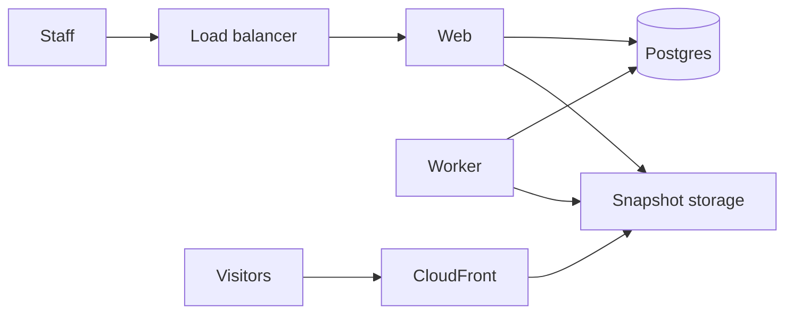

<!-- copy-review: required before announce -->

# Flagstage Core

Import the site you already have. Change it in chat. Publish when the preview looks right.

Flagstage Core is a self-hosted app for an organization that runs many accounts and many sites. Live sites are static files. The app is never on the visitor path.

[](LICENSE)
[](https://nodejs.org)
[](https://github.com/rera/flagstage-core/discussions)


## Features

- Import into a versioned static snapshot, with a plain-language fidelity report.
- Chat is the only way to request a change. An agent edits files in a sandbox and opens a preview.
- Approve publishes with a compare-and-swap. Roll back the same way.
- Organization, accounts, and two roles: admin and account admin.
- Email and password sign-in. An admin can promote or remove another admin.
- Custom domains as a copyable DNS checklist with live checks against public resolvers.
- Lead forms, with a signed webhook and SES mail, and cookie-free site analytics.
- Edits run through OpenCode. OpenCode calls Amazon Bedrock with the task role. There is no model API key.
- `flagstage admin add`, `flagstage account create`, and `flagstage import`.
- No telemetry and no update check.

## Quickstart

1. Edit `flagstage.config.json`. Set the domain, the organization name, the first admin email, the Bedrock model id, the region, and the SES from-address. Logo and brand live in that file too.
2. Run `./deploy.sh`. It builds the image, pushes it to ECR, and deploys the CloudFormation stack. Deploy in us-east-1 so CloudFront can use the certificate.
3. Delegate the domain to the name servers the script prints.

The app is `https://{domain}`. A published site is `https://{slug}.{domain}`, served from S3 through CloudFront. The web log prints a one-time sign-in link for `adminEmail`. A first run has no accounts and no sites.

## Local development

```bash
cp .env.example .env
docker compose up -d postgres
pnpm install
pnpm db:migrate
pnpm dev
```

Open http://localhost:3000 and sign in with the one-time link from the web log. `pnpm dev:sites` serves published files at `http://127.0.0.1:8088` for local viewing. That process is not an app route, and it is not how AWS serves a live site.

`pnpm e2e` signs in, imports a fixture, edits in chat, opens the preview, publishes, and reads the DNS checklist. Health check: http://localhost:3000/api/health.

## Self-hosting

The supported install is one container service on AWS, described in [docs/self-hosting/aws.md](docs/self-hosting/aws.md). `./deploy.sh` builds the image and deploys the CloudFormation stack. Delegate the name servers it prints. Core does not talk to a registrar.

A single virtual machine with Compose is [evaluation only](docs/self-hosting/single-vm.md).

Product settings are `flagstage.config.json`, checked against `flagstage.config.schema.json`. Secrets stay in the environment locally and in Secrets Manager on AWS. The environment reference is [docs/configuration.md](docs/configuration.md).

## Architecture



The web process is Next.js: the UI, auth, previews, forms, and the analytics collect endpoint. The worker is the same image running pg-boss: import, agent turns, publish, DNS checks, and analytics rollups. Postgres holds the data and the job queue. There is no Redis.

Agent turns run OpenCode as a subprocess in a temp directory. OpenCode is configured with the amazon-bedrock provider and the task role. The subprocess does not receive the database URL or static access keys.

## Compare

|                             | Flagstage Core                 | A traditional CMS     | Webflow or Squarespace  | A static-site generator | An AI app builder             |
| --------------------------- | ------------------------------ | --------------------- | ----------------------- | ----------------------- | ----------------------------- |
| You already have a site     | Import it                      | It is the site        | Rebuild                 | Rebuild                 | Clone into a new codebase     |
| Who edits                   | Anyone in the account, in chat | Whoever has the admin | Whoever has the project | Whoever has the repo    | Whoever can prompt a codebase |
| What visitors hit           | Static files                   | PHP                   | Their hosting           | Static files            | Their hosting                 |
| Approve before it goes live | Yes                            | Depends on plugins    | Their editor            | Your review process     | Varies                        |
| Identity                    | Email and password             | Plugins               | Their accounts          | Your git host           | Their accounts                |
| You run it                  | Yes                            | Yes                   | No                      | Yes                     | Usually no                    |

The cells describe the typical shape of each approach. A given product can differ.

## Roadmap

See [ROADMAP.md](ROADMAP.md). Ideas belong in [Discussions](https://github.com/rera/flagstage-core/discussions) first.

## Community

Questions, ideas, and things you shipped: [GitHub Discussions](https://github.com/rera/flagstage-core/discussions).

Bugs and feature requests: GitHub Issues. Read [CONTRIBUTING.md](CONTRIBUTING.md) before a pull request. Commits need a Developer Certificate of Origin sign-off (`git commit -s`), not a separate license agreement.

## Security

Report vulnerabilities privately. See [SECURITY.md](SECURITY.md).

## License and trademarks

[Apache-2.0](LICENSE). Copyright 2026 Rera. See [NOTICE](NOTICE) and [TRADEMARKS.md](TRADEMARKS.md).

## Hosted option

Don't want to run it? [Flagstage](https://flagstage.com) hosts it.
