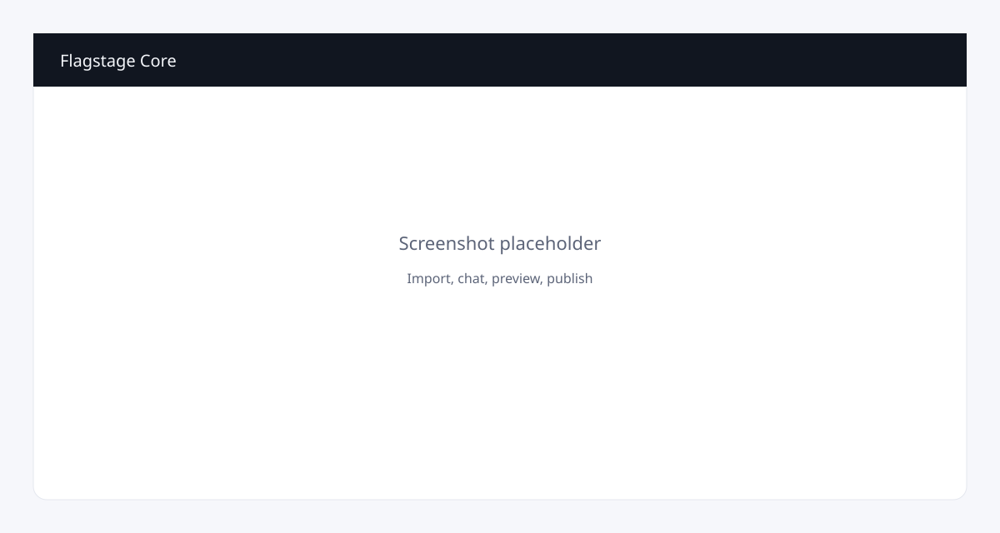
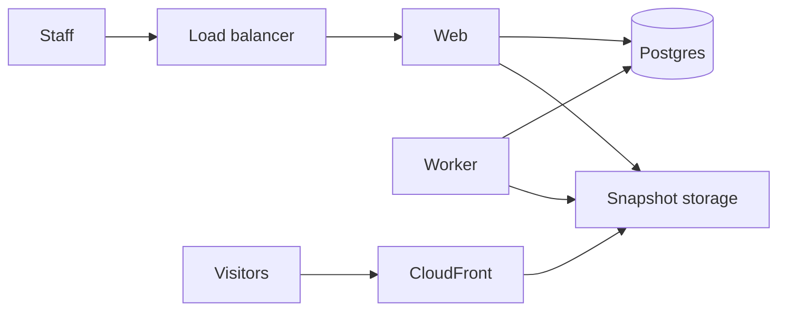

<!-- copy-review: required before announce -->

# Flagstage Core

Import the site you already have. Change it in chat. Publish when the preview looks right.

Flagstage Core is a self-hosted app for an organization that runs many accounts (a department, a section, a brand) and many sites. Live sites are static files. The app is never on the visitor path.

[](LICENSE)
[](https://github.com/rera/flagstage-core/discussions)



## Features

- WordPress import into a versioned static snapshot, with a plain-language fidelity report.
- Chat is the only way to request a change. An agent edits files in a sandbox and opens a preview.
- Approve publishes with a compare-and-swap. Roll back the same way.
- Organization, accounts, and roles: organization admin, account admin, editor, reviewer.
- OIDC, SAML 2.0, and SCIM 2.0. Group ids map to roles. No vendor-specific identity code.
- Custom domains as a copyable DNS checklist with live checks against public resolvers.
- Lead forms and cookie-free site analytics.
- Bring your own model API key, or run the local demo in mock mode with no key.
- No telemetry and no update check.

## Quickstart

```bash
cp .env.example .env
docker compose up
```

Open http://localhost:3000. The demo organization is loaded when `SEED_DEMO=1` (the compose default). Sign-in for the seeded admin lands in a later step of first-run setup; until then the health check is http://localhost:3000/api/health.

Hot reload against the same Postgres:

```bash
docker compose up -d postgres
pnpm install
pnpm db:migrate
pnpm dev
```

## Self-hosting

The supported install is one container service on AWS, described in [docs/self-hosting/aws-opentofu.md](docs/self-hosting/aws-opentofu.md) and built by the OpenTofu module in `infra/opentofu`. You create the DNS records the module prints. Core does not talk to a registrar.

A single virtual machine with Compose is [evaluation only](docs/self-hosting/single-vm.md).

Configuration is environment variables, validated at boot. The reference is [docs/configuration.md](docs/configuration.md).

## Architecture



The web process is Next.js: the UI, auth, previews, forms, and the analytics collect endpoint. The worker is the same image running pg-boss: import, agent turns, publish, DNS checks, and analytics rollups. Postgres holds the data and the job queue. There is no Redis.

Agent turns run OpenCode as a subprocess in a temp directory. The subprocess environment has the model key and model settings only. It does not receive the database URL or cloud credentials. A mock runner ships for local development.

## Compare

|                             | Flagstage Core                 | WordPress            | Webflow or Squarespace  | A static-site generator | An AI app builder             |
| --------------------------- | ------------------------------ | -------------------- | ----------------------- | ----------------------- | ----------------------------- |
| You already have a site     | Import it                      | It is the site       | Rebuild                 | Rebuild                 | Clone into a new codebase     |
| Who edits                   | Anyone in the account, in chat | Whoever has wp-admin | Whoever has the project | Whoever has the repo    | Whoever can prompt a codebase |
| What visitors hit           | Static files                   | PHP                  | Their hosting           | Static files            | Their hosting                 |
| Approve before it goes live | Yes                            | Depends on plugins   | Their editor            | Your review process     | Varies                        |
| Identity                    | OIDC, SAML, SCIM               | Plugins              | Their accounts          | Your git host           | Their accounts                |
| You run it                  | Yes                            | Yes                  | No                      | Yes                     | Usually no                    |

## Roadmap

See [ROADMAP.md](ROADMAP.md). Ideas belong in [Discussions](https://github.com/rera/flagstage-core/discussions) first.

## Community

Questions, ideas, and things you shipped: [GitHub Discussions](https://github.com/rera/flagstage-core/discussions).

Bugs and feature requests: GitHub Issues. Read [CONTRIBUTING.md](CONTRIBUTING.md) before a pull request. Commits need a Developer Certificate of Origin sign-off (`git commit -s`), not a separate license agreement.

## Security

Report vulnerabilities privately. See [SECURITY.md](SECURITY.md).

## License and trademarks

[Apache-2.0](LICENSE). Copyright 2026 Rera. See [NOTICE](NOTICE) and [TRADEMARKS.md](TRADEMARKS.md).

## Hosted option

Don't want to run it? [Flagstage](https://flagstage.com) hosts it.
