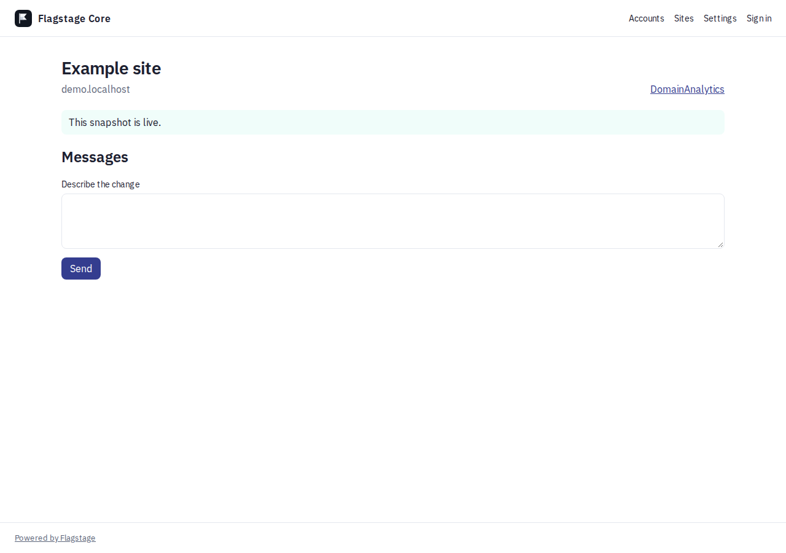
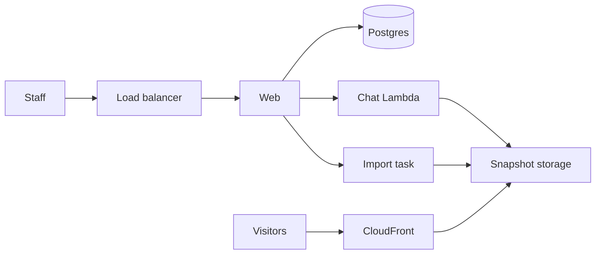

<!-- copy-review: required before announce -->

# Flagstage Core

Import the site you already have. Change it in chat. Publish when the preview looks right.

Flagstage Core is self-hosted software for a team that runs many accounts and many sites. Someone on the team edits a site in chat, looks at a preview, and publishes. Live sites are static files. Visitors never hit the app.



## Quickstart

1. Edit `flagstage.config.json`. Set the domain, the organization name, the first admin email, the Bedrock model id, the region, and the SES from-address. Logo and brand live in that file too.
2. Use a release, or fork and customize. A release's notes include a Launch stack link for the CloudFormation template, with the public image pinned as `ImageUri`. From a checkout, `./deploy.sh` deploys that same public image (`public.ecr.aws/rera/flagstage-core:0.1.0`). `./deploy.sh --build` builds the image and pushes it to your own ECR. Deploy in us-east-1 so CloudFront can use the certificate.
3. Delegate the domain to the name servers the script prints.

The app is `https://{domain}`. A published site is `https://{slug}.{domain}`, served from S3 through CloudFront. The web log prints a one-time sign-in link for `adminEmail`. A first run has no accounts and no sites.

Publish can also be scheduled. In the builder, Schedule pins the current draft and a time in the site's time zone, with an optional revert time. Chat accepts the same request in plain words. On AWS, EventBridge Scheduler fires the publish. Locally, the web process checks every few seconds. See [What happens when](docs/design/what-happens-when.md).

To work on a checkout instead:

```bash
cp .env.example .env
docker compose up -d postgres
pnpm install
pnpm db:migrate
pnpm dev
```

Open http://localhost:3000 and sign in with the one-time link from the web log. `pnpm dev:sites` serves published files at `http://127.0.0.1:8088` for local viewing. That process is not an app route.

## Roles

| Who            | Sidebar                                                                                      | Can do                                            |
| -------------- | -------------------------------------------------------------------------------------------- | ------------------------------------------------- |
| Account member | One account. Open site sections, plus All sites, People, Usage                               | Read that account's sites, people, and usage      |
| Account admin  | The same. New site in the site switcher. Account switcher only with two or more accounts     | Import, invite, and publish inside those accounts |
| Org admin      | That account, plus Admin: Accounts, Sites, People, Usage, Settings, and the account switcher | Every account, and the install settings           |

The top of the sidebar is Account › Site. One site in the account opens on that site's overview. The desktop sidebar collapses to an icon rail. Addresses look like `/a/harbor/sites`. Opening another account's address shows no access.

## Architecture



The web process is one always-on Next.js container: the UI, auth, previews, forms, and the analytics collect endpoint. Chat runs OpenCode in one Lambda. Imports run as one-off tasks. Postgres holds the transcript and the draft lock. There is no Redis and no always-on worker.

OpenCode calls Amazon Bedrock with the task role. The subprocess does not receive the database URL or static access keys.

Product settings are `flagstage.config.json`. Secrets stay in the environment locally and in Secrets Manager on AWS.

## Docs

- [Documentation index](docs/index.md)
- [Getting started](docs/getting-started.md)
- [Deploy on AWS](docs/self-hosting/aws.md)
- [Configuration](docs/configuration.md)
- [Architecture](docs/architecture.md)
- [Upgrading](docs/upgrading.md)

## Using Flagstage Core as a dependency

A downstream repository can deploy its own stack from a pinned Core release. Pin one semver tag. Upgrade in a small pull request that moves the pin to the next tag, builds from that tag, and runs the downstream checks. Roll back by reverting that pull request. If the new version has already migrated the database, restore a backup before starting the previous image. See [Upgrading](docs/upgrading.md).

The workspace packages are private, and the apps depend on each other with `workspace:*`. They are not published to npm. A pnpm git dependency on one workspace path, such as `github:rera/flagstage-core#vX.Y.Z&path:apps/web`, does not install. Pin the repository with a submodule at a tag.

```bash
git submodule add https://github.com/rera/flagstage-core.git core
git -C core fetch origin tag vX.Y.Z
git -C core checkout vX.Y.Z
git add core
```

Replace `vX.Y.Z` with the tag. The parent repository records that commit. To upgrade, fetch the new tag, check it out, and commit the submodule pointer again.

Keep `flagstage.config.json` in the downstream repository. The image copies that filename from the build context, so copy the downstream file over a throwaway build directory. Do not commit it into the submodule.

```bash
rm -rf /tmp/flagstage-build
cp -a core /tmp/flagstage-build
cp deploy/flagstage.config.json /tmp/flagstage-build/flagstage.config.json
docker build -f /tmp/flagstage-build/docker/Dockerfile \
  -t registry.example.com/flagstage-core:vX.Y.Z \
  /tmp/flagstage-build
docker build -f /tmp/flagstage-build/docker/Dockerfile --target lambda \
  -t registry.example.com/flagstage-core:vX.Y.Z-lambda \
  /tmp/flagstage-build
```

`deploy/flagstage.config.json`:

```json
{
  "domain": "sites.example.com",
  "orgName": "Example Organization",
  "adminEmail": "admin@example.com",
  "bedrockModelId": "amazon.nova-micro-v1:0",
  "region": "us-east-1",
  "sesFrom": "noreply@sites.example.com",
  "brand": {
    "name": "Example",
    "color": "#1f4d3a"
  }
}
```

`brand.logo` is optional. It is a path relative to the config file, and that file has to be in the build directory too. The app reads this file at startup. `FLAGSTAGE_CONFIG` can point at another path.

Pass stack parameters from the downstream repository. The template to deploy is the one in the pin, `core/infra/cloudformation/template.yaml`. `Domain`, `BedrockModelId`, and `SesFrom` should match the config file. `ImageUri` and `LambdaImageUri` are the images built from the same tag. Deploy in us-east-1 so CloudFront can use the certificate.

```bash
aws cloudformation deploy \
  --region us-east-1 \
  --stack-name flagstage \
  --template-file core/infra/cloudformation/template.yaml \
  --capabilities CAPABILITY_NAMED_IAM \
  --parameter-overrides \
    Domain=sites.example.com \
    BedrockModelId=amazon.nova-micro-v1:0 \
    SesFrom=noreply@sites.example.com \
    ImageUri=registry.example.com/flagstage-core:vX.Y.Z \
    LambdaImageUri=registry.example.com/flagstage-core:vX.Y.Z-lambda \
    Name=flagstage
```

`Name` is a short prefix for resource names. `AlarmEmail` is optional. Leave the importer model parameters at their defaults unless the stored importer setting uses another model.

## Releases

There are no git tags yet. A version is an annotated semver tag on `main`, named `vX.Y.Z`, for example `v0.1.0`. That tag is what a downstream pins. The workspace packages stay private. How to cut a tag is [RELEASING.md](RELEASING.md). CI does not create tags.

## Contributing

Read [CONTRIBUTING.md](CONTRIBUTING.md) before a pull request. Commits need a Developer Certificate of Origin sign-off (`git commit -s`). The license is [Apache-2.0](LICENSE). Report vulnerabilities privately, as [SECURITY.md](SECURITY.md) describes.
