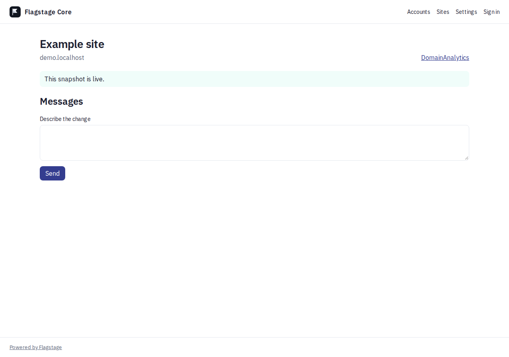
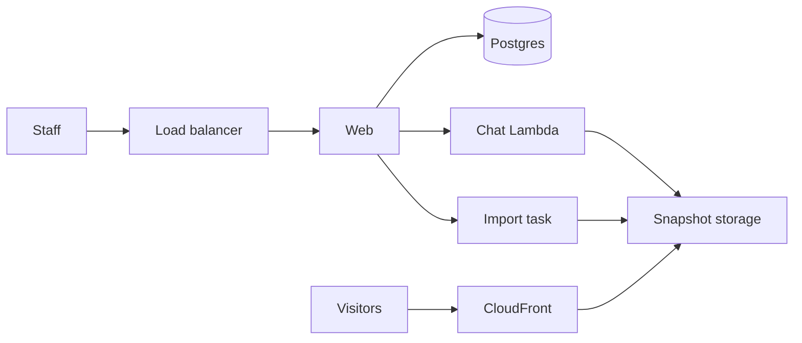

<!-- copy-review: required before announce -->

# Flagstage Core

Import the site you already have. Change it in chat. Publish when the preview looks right.

Flagstage Core is self-hosted software for a team that runs many accounts and many sites. Someone on the team edits a site in chat, looks at a preview, and publishes. Live sites are static files. Visitors never hit the app.



## Quickstart

1. Edit `flagstage.config.json`. Set the domain, the organization name, the first admin email, the Bedrock model id, the region, and the SES from-address. Logo and brand live in that file too.
2. Use a release, or fork and customize. A release's notes include a Launch stack link for the CloudFormation template, with the public image pinned as `ImageUri`. From a checkout, `./deploy.sh` deploys that same public image (`public.ecr.aws/rera/flagstage-core:0.1.0`). `./deploy.sh --build` builds the image and pushes it to your own ECR. Deploy in us-east-1 so CloudFront can use the certificate.
3. Delegate the domain to the name servers the script prints.

The app is `https://{domain}`. A published site is `https://{slug}.{domain}`, served from S3 through CloudFront. The web log prints a one-time sign-in link for `adminEmail`. A first run has no accounts and no sites.

Publish can also be scheduled. In the builder, Schedule pins the current draft and a time in the site's time zone, with an optional revert time. Chat accepts the same request in plain words. On AWS, EventBridge Scheduler fires the publish. Locally, the web process checks every few seconds. See [What happens when](docs/design/what-happens-when.md).

To work on a checkout instead:

```bash
cp .env.example .env
docker compose up -d postgres
pnpm install
pnpm db:migrate
pnpm dev
```

Open http://localhost:3000 and sign in with the one-time link from the web log. `pnpm dev:sites` serves published files at `http://127.0.0.1:8088` for local viewing. That process is not an app route.

## Architecture



The web process is one always-on Next.js container: the UI, auth, previews, forms, and the analytics collect endpoint. Chat runs OpenCode in one Lambda. Imports run as one-off tasks. Postgres holds the transcript and the draft lock. There is no Redis and no always-on worker.

OpenCode calls Amazon Bedrock with the task role. The subprocess does not receive the database URL or static access keys.

Product settings are `flagstage.config.json`. Secrets stay in the environment locally and in Secrets Manager on AWS.

## Docs

- [Documentation index](docs/index.md)
- [Getting started](docs/getting-started.md)
- [Deploy on AWS](docs/self-hosting/aws.md)
- [Configuration](docs/configuration.md)
- [Architecture](docs/architecture.md)
- [Upgrading](docs/upgrading.md)

## Contributing

Read [CONTRIBUTING.md](CONTRIBUTING.md) before a pull request. Commits need a Developer Certificate of Origin sign-off (`git commit -s`). The license is [Apache-2.0](LICENSE). Report vulnerabilities privately, as [SECURITY.md](SECURITY.md) describes.
