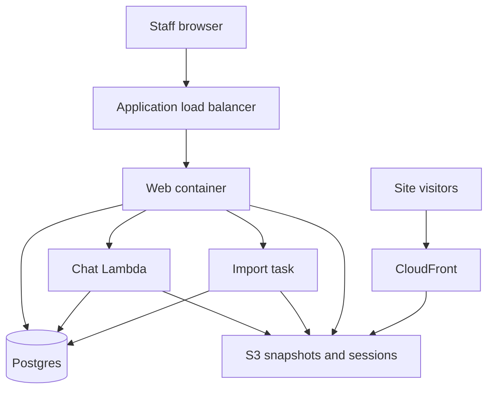

<!-- copy-review: required before announce -->

# Architecture

One web container stays up. It serves the app, signs people in, and starts work. It does not run the editor.

Chat is one container-image Lambda. Each turn loads the draft and the OpenCode session from S3, runs OpenCode 2.2.7 headless, and writes the draft and the session back. The transcript lives in Postgres. Progress is a `NOTIFY` that the web relays over server-sent events. The page also polls every 2 seconds. Near the 15-minute limit the Lambda checkpoints and starts another invocation.

Imports are one-off Fargate tasks from the same web image, started with `RunTask` and the command `import`. The task writes pages found, pages done, and skipped pages onto the import row. Locally, with no cluster set, the web process runs that same function in the background.

Published HTML is read from object storage by CloudFront. The app is not on that path. Previews of the current draft are auth-gated at `/sites/<id>/live`.

## Agent isolation

The Lambda role can call Bedrock and the snapshot bucket. The editor subprocess receives the task-role credential URI and the region. It does not receive `DATABASE_URL` or static access keys.

## What is intentionally absent

- No Redis and no always-on worker.
- No billing, plans, or a review queue.
- No phone-home telemetry.
- No registrar automation. Operators create DNS records from a checklist.
