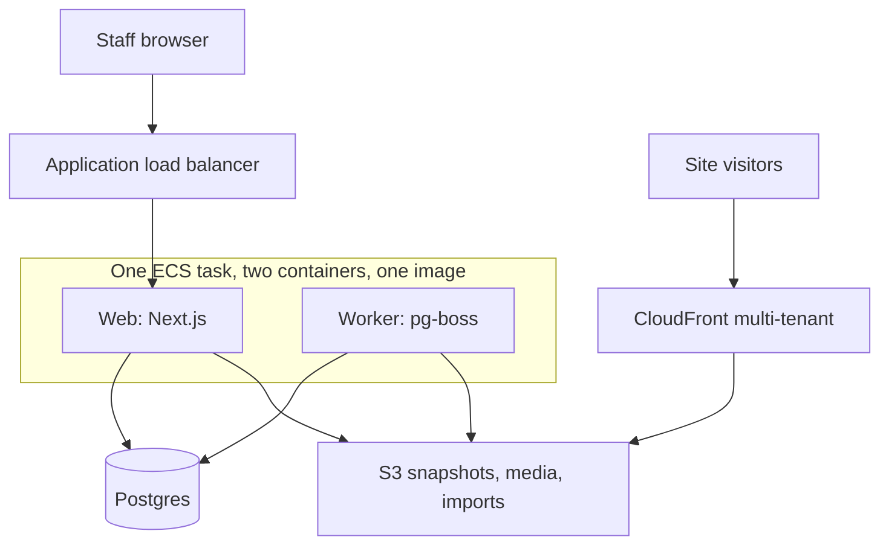

<!-- copy-review: required before announce -->

# Architecture

Live HTML is read from object storage by CloudFront. A viewer-request function reads the hostname from a KeyValueStore and rewrites the URI onto that site's current snapshot prefix. The app is not in that path. Form posts and the analytics beacon are the requests that reach the app. In local development, `node script/dev-sites.mjs` serves the published files from the host map. It is not an app route.

Previews are `{APP_URL}/preview/{token}`, served by the web process, signed-in, and they expire. There is no preview hostname.

Jobs live in Postgres via pg-boss. The web process enqueues an import or a chat turn and returns. The worker runs the crawl and the editor. Chat updates use server-sent events fed by `LISTEN/NOTIFY`, and the client falls back to polling every 2 seconds. The event payload includes the import status and the thread status, so the site page reloads when a job finishes.

## Agent isolation

`AgentRunner` has one implementation, `subprocess`. The worker downloads the snapshot into a temp directory, runs OpenCode with file tools only, and uploads the diff. The subprocess environment contains the model key and model settings. It does not contain `DATABASE_URL` or cloud credentials. The default timeout is 10 minutes.

This is a weaker boundary than a separate function with its own role. A future `ecs-task` runner is out of scope. The trade-off is one small service instead of a second compute platform.

## What is intentionally absent

- No Redis, no queue service, no inbound email, SMS, or Slack.
- No billing.
- No phone-home telemetry.
- No registrar automation. Operators create DNS records from a checklist.
