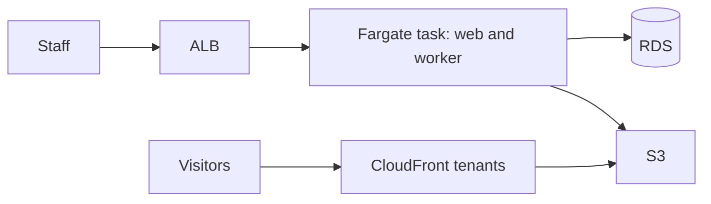

# Flagstage Core on AWS

One Fargate service, one Postgres database, one private bucket, and a CloudFront multi-tenant distribution. There is no NAT gateway.



## Cost

About **$83 per month** in us-east-1 before traffic and model usage:

| Piece | Rough monthly |
| --- | ---: |
| Fargate, 1 vCPU and 2 GB, always on | $36 |
| Application load balancer | $22 |
| Three public IPv4 addresses | $11 |
| RDS `db.t4g.micro`, 20 GB, encrypted | $13 |
| S3, CloudFront, logs, secrets | $1 |
| **Total** | **$83** |

A NAT gateway is not included. Adding one would cost more than the database.

## What you run

The module does not apply itself. From a checkout:

```bash
cd infra/opentofu
tofu init -backend=false
tofu plan
tofu apply
```

Prefer the examples, which call this module by git source. See `examples/minimal` and `examples/existing-vpc`.

Published sites are CloudFront tenants. The app creates a tenant when a hostname is added. The viewer-request function reads the hostname from a KeyValueStore and rewrites the request onto that site's snapshot prefix. The viewer-response function sets content type and cache headers.

## DNS you create

Unless `create_route53_records` is true, create these records yourself:

| Name | Type | Value |
| --- | --- | --- |
| The app hostname | A or ALIAS | The load balancer DNS name |
| Each site hostname | CNAME | The connection-group endpoint |
| Certificate validation | CNAME | The records AWS shows for the app certificate |

An apex site hostname needs an ALIAS, ANAME, or flattened CNAME at a DNS host that supports it. This module does not talk to a registrar.
